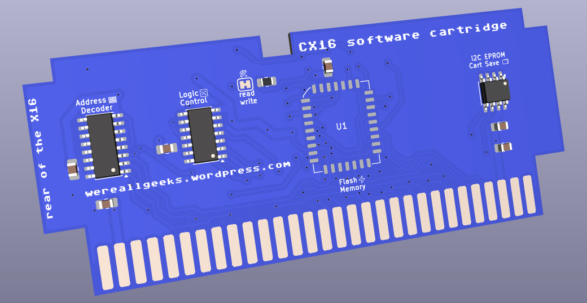

# CX16-HALF-CART
## CX-16 and OtterX half-sized flash cartridge with EEPROM

### Purpose

This is my interpretation of a simple cartridge for the X16 architecture.
It is intended as a simple cart meant to be programmed within the X16 environment and has minimal components to achieve this goal.

#### History
The OtterX is an X16 clone that is fully compatible with the X16 architecture.

After I completed [construction of the computer the open-source way](https://wereallgeeks.wordpress.com/2026/09/17/completeotterx/), I looked around and didn't initially find an open-source cartridge solution; which is why I cam up with my own.
To achieve this goal, I found a great lot of information on the [git of jkominek](https://github.com/jkominek) - he has a very useful [X16 expansion port & cartridge component/footprint library for KiCad 8](https://github.com/jkominek/x16expansion) that I imported in kicad 10; he also has the [basic design for a simple cartridge](https://github.com/jkominek/x16simplecart) in PDF format, a great head start to design my X16 cartridge.

I started from that design,designed the PCB in surface mount with the idea of being able to purchase a lot of PCBs pre-assembled using PCBA services.

I altered the footprint and routed the board by hand, keeping it 2-layer. I think I like the end result.

  

Disclaimer - After spending much time designing my own cart, I was pointed to [this open-source cartridge](https://gitlab.com/m00dawg/commander-x16-cartridges) from [m00dawg](https://gitlab.com/m00dawg)... who also encouraged and guided in this design along with [Wavicle](https://github.com/jburks) and Morphinejh on the X16 discord - thanks.

### Bill of Material

The hardware included on the PCB is as follow
- SST39SF040-70-4C-NHE
- - The FLASH memory, same type as on the CX16 or OtterX but in PLCC form
- 24LC128-I/P
- - I2C EEPROM to save on cart
- SN74ACT00D
- - NAND gates (SOIC14) to assist with logic
- CD74ACT138M96
- - Address decoder (SOIC16)
- CL21B105KBFNNNE (x2)
- - 1uF Decoupling capacitors
- CL21B104KBCNNNC (x4)
- - 100nF Decoupling capacitors
- RC0805FR-0710KL
- - 10k ohm pull-up resistor to put ROM read-only when JP1 is cut open

### How to burn ROM cart

X16 onboard cards or carts can be burn with the same X16 update utility used to update the VERA board or firmware ROM, the X16-FLASH utility

The software is intended to be part of the [essential SD card](https://github.com/cx16forum/sdcard) software, but can also be [found on git](https://github.com/FlightControl-User/x16-flash)

Cartridge binaries would be saved alongside the software and written directly on the X16 hardware.

### Copyright (C) 2026 Marsupial (wereallgeeks.wordpress.com) 

This PCB Design is open hardware: you can redistribute it and/or modify it under the terms of the Creative Commons Attribution-NonCommercial-ShareAlike 4.0 International License (CC BY-NC-SA 4.0), as long as PCB attribution markings and silkscreen remains present on the final product.
To view a copy of this license, visit creativecommons.org
Commercial profitability is strictly prohibited under the terms of this license.
This design is distributed in the hope that it will be useful, but WITHOUT ANY WARRANTY; without even the implied warranty of MERCHANTABILITY or FITNESS FOR A PARTICULAR PURPOSE, or FUNCTIONALITY. 

See the CC BY-NC-SA 4.0 license details for more information.
